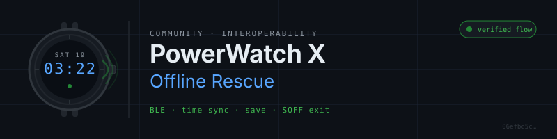

# MATRIX PowerWatch X Offline Rescue Notes

Community notes for restoring basic local operation of legacy MATRIX PowerWatch / PowerWatch X devices after the official cloud services were retired.

> **Status:** community research / personal repair notes. Not an official MATRIX or PowerWatch release.

## What this project documents

These notes describe a BLE-based rescue flow that can restore basic watch operation:

- connect to the watch over BLE;
- write current UTC time and timezone;
- save settings to memory;
- exit the pairing/sync screen;
- verify that the watch displays the normal time screen.

The process was confirmed on one PowerWatch X device. Other devices may need changes, especially selecting the correct BLE MAC address and timezone.

## Important privacy note

This public version intentionally avoids personal details such as:

- owner name;
- local Windows usernames and paths;
- phone model;
- exact private watch MAC address;
- exact serial number.

If you publish logs or screenshots, review them first and remove personal identifiers.

## Background

The original PowerWatch mobile app depended on cloud services that are no longer available. Legacy BLE protocol notes made it possible to identify the local commands used by the watch for time sync, pairing/config, save, and mode exit.

This repository is intended to preserve the technical findings so other owners can build a clean rescue utility or adapt the method for their own device.

## BLE protocol highlights

User/config command family:

```text
84xx
```

Important commands:

```text
840107{UTC}{TZ}      set UTC + timezone
84010811223344       write example pair code
8421                 save data to memory
8440                 show sync animation
8441                 hide sync animation
810F050082           SOFF / normal exit
```

Dangerous commands:

```text
8422                 factory reset / unpair
8425                 enter shipmode
8430522C5E08         debugger lock
```

Do **not** send dangerous commands unless you explicitly understand and want their effect.

## Timezone format

The time command uses:

```text
840107{8 hex digits Unix UTC}{4 hex digits timezone minutes}
```

Examples:

```text
UTC+1  = 60 minutes  = 003C
UTC+2  = 120 minutes = 0078
UTC-5  = -300 minutes as signed 16-bit = FED4
```

For Central Europe:

```text
CET  winter = UTC+1 = 003C
CEST summer = UTC+2 = 0078
```

## Working flow observed

A successful final flow was:

```text
1. query/init watch
2. send current time/timezone: 840107{UTC}{TZ}
3. send pair/config values as required by the app flow
4. save: 8421
5. exit: 810F050082
6. confirm the physical watch displays the normal time screen
```

Earlier testing found that `8440` was useful as a visible effect probe: it changed the watch-side state from a failed-looking pairing screen to a pairing-completed screen. The final normal time display was reached after save + SOFF/exit.

## BLE UUIDs seen in the legacy app flow

Vendor service:

```text
00002760-08c2-11e1-9073-0e8ac72e1011
```

Characteristics:

```text
00002760-08c2-11e1-9073-0e8ac72e0011  classic write/RX candidate
00002760-08c2-11e1-9073-0e8ac72e0012  notify/TX
00002760-08c2-11e1-9073-0e8ac72e0013  PowerWatch X write/RX candidate
```

For the tested PowerWatch X flow, writes were sent to the PowerWatch X write characteristic and notifications were read from the notify characteristic.

## What should be built next

For public distribution, the best long-term solution is **not** a repackaged vendor APK. It should be a clean-room rescue utility that:

1. scans for nearby PowerWatch devices;
2. lets the user choose their device;
3. sends time/timezone based on the phone timezone;
4. optionally sends save/exit commands;
5. clearly avoids factory reset or shipmode unless explicitly requested.

## Repository files

```text
README.md                 GitHub overview
TECHNICAL_NOTES.md        protocol details and implementation notes
NRF_MANUAL_COMMANDS.md    manual nRF Connect fallback notes
BUILD.md                  build instructions for the clean-room prototype
PRIVACY.md                checklist for sanitizing logs/screenshots
DISCLAIMER.md             legal/safety notes
NOTICE.md                 non-affiliation / no-proprietary-content notice
LICENSE                   MIT license for original repository content
index.html                readable standalone HTML guide
OpenPowerWatchSync/       clean-room Android prototype source
.github/ISSUE_TEMPLATE/   sanitized bug/compatibility report templates
```

## Legal / distribution note

These notes are for interoperability, preservation, and repair of user-owned legacy hardware. Do not publish proprietary APKs, copied vendor assets, branding, decompiled source, private MAC/serial data, or private protocol PDFs unless you have the right to do so. Prefer a clean-room implementation for any public release.

## Clean-room Android utility prototype

This repository also includes a minimal clean-room Android prototype under:

```text
OpenPowerWatchSync/
```

It does not include the original vendor APK, copied assets, decompiled source, private MAC addresses, or private serial numbers. It scans/selects a BLE device and sends the documented time/save/exit flow.

Prototype status:

- builds successfully as a debug APK;
- command framing has been checked against known-good chunks for `8421`, `8440`, and `810F050082`;
- real-device BLE testing of the clean-room prototype is still pending.
